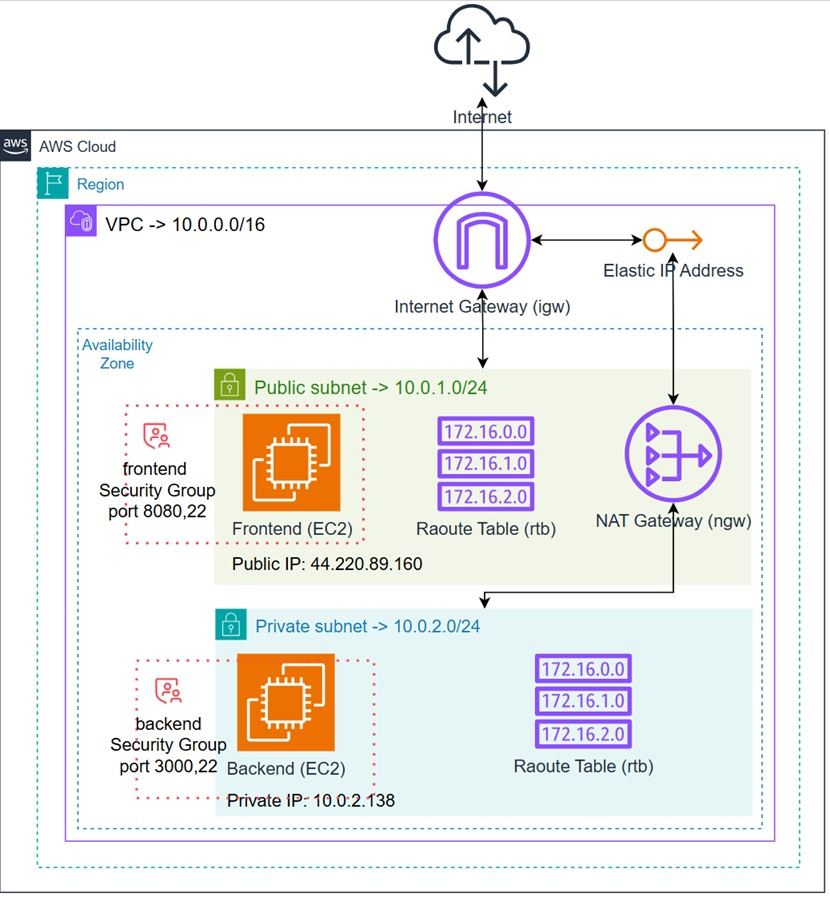
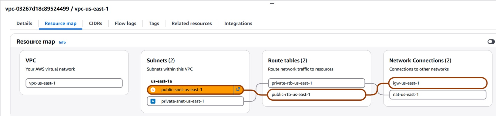
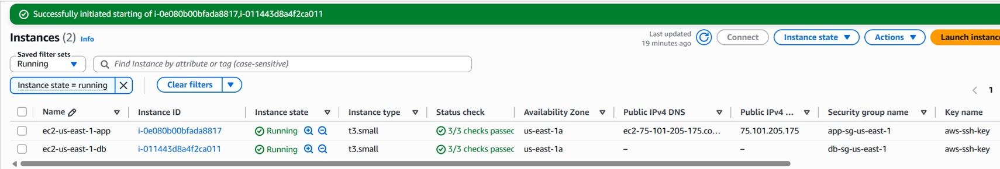

## aws
#### Note:
```
Optimizer : Details -> AWS Compute Optimizer finding – AWS analyzes instance utilization and provides recommendations for optimal instance type/size in terms of cost and performance.  
View All resources in all regions : E2C -> AWS Global View
Check bill : Billing and Cost Management -> Credits / https://us-east-1.console.aws.amazon.com/costmanagement/home?region=us-east-1#/credits

```
#### 3 Ways to communicate with AWS:
```
1. AWS Console / UI
2. AWS API -> aws-cli
3. AWS SDK -> python library
```
#### Multiple ways to connect EC2:
```
1. AWS UI Console / Private Shell - via public IP (EC2 Instance Connect)
2. AWS SSM -> Systems Session Manager - no public IP or open ports needed (agent-based, via AWS API)
3. SSH Connection using Key-Pair - via public IP, requires port 22 open
```
#### Simple Task:
```
1. Create AWS Account
2. Create New EC2 Using Default VPC & Subnet
3. Connect EC2 Via SSH Using Key-Pair (ssh -i ./aws-ssh-key.pem ubuntu@3.236.229.43)
4. Install Docker Service On Fedora/Ubuntu/Debian
5. Run Nginx As Docker Container Using Port 80 (docker run -d -p 80:80 nginx)
6. Allow Inbound Rule For Port 80
7. Access The Nginx Website Via Browser
```
##### Creating an EC2 Instance in AWS
```
1. Navigating to EC2
    Open the EC2 Dashboard → click Launch Instance.
2. Instance Configuration
    - Instance Name:
        (e.g., my first instance)
    - AMI (Amazon Machine Image):
        A template containing the software configuration.
    - Instance Type:
        For light workloads — t2.micro (free tier eligible).
        t3.micro is newer but NOT free tier — it incurs charges.
    - Key Pair:
        If you already have one, you can reuse it; otherwise, create a new key pair.
        The .pem file downloads automatically — needed for SSH access.
    - Storage:
        Free tier: up to 30 GB of EBS (General Purpose SSD or magnetic storage).
3. Launching the Instance
    - Review the configuration summary (type, security group, storage).
    - Click Launch Instance.
    - Launch logs show progress (initializing, creating security group, etc.)
4. Checking the Instance in the Dashboard
    - Visible details include:
        Instance State (Running), Instance Type, Availability Zone, Status Checks.
5. Connecting to the Instance
    - Select the instance → Connect → EC2 Instance Connect.
6. Open port 22 & 80 for SSH,HTTP connections
    - EC2 → Security Groups → sg-XXXXXX → Edit inbound rules
      (Type: SSH, Source: Anywhere IPv4)
      (Type: HTTP, Source: Anywhere IPv4) → Save rule
```
##### Connecting to the Instance via SSH *.pem file
```
chmod 600 aws-ssh-key.pem
ssh -i ./aws-ssh-key.pem ubuntu@3.236.229.43
```
##### Install Docker:
```
-   sudo apt update -y
-   sudo apt install docker.io -y
-   sudo systemctl start docker     :  run now
-   sudo systemctl enable docker    :  run automatically at every system startup
-   sudo usermod -aG docker $USER   :  adds the current user to docker group
re-login
-   groups                          :  list of all groups the current user is a member of
-   docker run -d -p 80:80 nginx
-   Connect http://3.236.229.43:80
```

#### Install VsCode on EC2 example :
```
1. curl -fsSL https://code-server.dev/install.sh | sh
2. sudo systemctl start code-server@$USER
3. nano ~/.config/code-server/config.yaml | change password and 127.0.0.1 -> 0.0.0.0
4. sudo systemctl restart code-server@$USER
5. Connect http://3.236.229.43:8080
    ....
Install NodeJs on EC2:
1. curl -fsSL https://deb.nodesource.com/setup_18.x | sudo bash -
2. sudo apt install -y nodejs
```
### Advance Task:
```
1. Create New VPC
2. Create Public & Private Subnets
3. Configure Internet Gateway & NAT Gateway
4. Configure Public & Private Route Tables
5. Configure Security Group For APP & DB Workloads
6. Create EC2 Per Subnet & Check Network Connecivity
7. Install NodeJs On Each EC2 Instance
8. Write Simple Code For Frontend & Backend
9. Bonus: Add Route53 Record
```

<p align="left">
  
</p>


##### VPC (Virtual Private Cloud)
```
VPC - is an isolated logical network in the public cloud where you can securely host your virtual machines, databases and services.   
https://docs.aws.amazon.com/vpc/latest/userguide/what-is-amazon-vpc.html  

VPC -> Your VPCs -> Create VPC -> 
[v] VPC only
Name tag: vpc-us-east-1
IPv4 CIDR: 10.0.0.0/16
# Enable DNS 
VPC → Your VPCs → vpc-us-east-1 → Actions → Edit VPC settings
[✓] Enable DNS resolution
[✓] Enable DNS hostnames

Explanation:
## CIDR Notation: IP/prefix (e.g., 10.0.0.0/16) | ## Common Prefixes & Address Counts                | ## Typical VPC Setup
- IP = 32 bits (4 x 8-bit blocks): 10.0.0.0     | /16  → 65,536 addresses  (10.0.0.0 – 10.0.255.255) | VPC:            10.0.0.0/16  (whole range)
- /prefix = number of FIXED bits (network part) | /24  →    256 addresses  (10.0.1.0 – 10.0.1.255)   | Public Subnet:  10.0.1.0/24  (256 IPs, AZ-a)
- Remaining bits = free for host addresses      | /28  →     16 addresses  (10.0.1.0 – 10.0.1.15)    | Private Subnet: 10.0.2.0/24  (256 IPs, AZ-b)
                                                | /32  →      1 address    (single host)             |
```
##### Public & Private Subnets
```
VPC -> Subnets -> Create subnet
# public subnet #
VPC ID: Create subnets in this VPC -> vpc-us-east-1
Subnet name: public-snet-us-east-1a
Availability Zone: United States (N. Virginia) / use1-az1 (us-east-1a)
IPv4 CIDR: 10.0.1.0/24

# private subnet #
VPC ID: Create subnets in this VPC -> vpc-us-east-1
Subnet name: private-snet-us-east-1a
Availability Zone: United States (N. Virginia) / use1-az1 (us-east-1a)
IPv4 CIDR: 10.0.2.0/24
```

##### Internet Gateway & NAT Gateway
Internet Gateway (IGW)   
```
AWS Internet Gateway (IGW) is VPC component that enables communication between your Amazon VPC instances and the public internet.
VPC -> Internet gateways -> Create internet gateway
Name tag: igw-us-east-1
Attach to VPC: vpc-03267d18c89524499 | vpc-us-east-1
```
NAT Gateway  
```
Network Address Translation (NAT) service. Allows cloud resources in a private subnet (like databases or backend servers) to connect to services outside your VPC but external services can't initiate a connection with those instances.
1. VPC -> Elastic IP addresses -> Allocate Elastic IP address -> Allocate (34.198.205.70)
2. VPC -> NAT gateways -> Create NAT gateway
    Name: nat-us-east-1
    Availability mode: Zonal
    Subnet: public-snet-us-east-1a
    Elastic IP allocation ID: eipalloc-us-east-1
```
##### Configure Public & Private Route Tables
```
VPC -> Route tables -> Create route table 
# public #
    Name: public-rtb-us-east-1
    VPC: vpc-03267d18c89524499 | vpc-us-east-1
    subnet associations -> Edit subnet associations: public-snet-us-east-1a
    Routes -> Edit routes: {Destination: 0.0.0.0/0 , Target: Internet gateways -> igw-us-east-1}
# private #
    Name: private-rtb-us-east-1
    VPC: vpc-03267d18c89524499 | vpc-us-east-1
    subnet associations -> Edit subnet associations: private-snet-us-east-1a
    Routes -> Edit routes: {Destination: 0.0.0.0/0 , Target: NAT Gateway -> nat-us-east-1}
```
<p align="left">
  
</p>

##### Security Group For APP & DB Workloads
```
EC2 -> Security Groups -> Create security group
Security group name: app-sg-us-east-1
VPC: vpc-03267d18c89524499 | vpc-us-east-1
Inbound rules -> Edit inbound rules:       (Type: SSH, Source: Anywhere IPv4 0.0.0.0/0)  -  SSH port from all
                                           (Type: Custom TCP, Port range: 8080, Source: Anywhere IPv4 0.0.0.0/0)  -  app port
&
Security group name: db-sg-us-east-1
VPC: vpc-03267d18c89524499 | vpc-us-east-1
Inbound rules -> Edit inbound rules:       (Type: All ICMP - IPv4, Source: Anywhere IPv4)  - ping connamd: ping ip-10-0-2-138
                                           (Type: SSH, Source: Custom {app-sg-us-east-1})  -  SSH port from App security group
                                           (Type: Custom TCP, Port range: 3000, Source: Custom {app-sg-us-east-1})  -  app port
```
##### Create EC2 Per Subnet & Check Network Connecivity
```
# DB #
Name: ec2-us-east-1-db
Application and OS Images: Ubuntu
Instance type: t3.small
Key pair (login): aws-ssh-key  - already existing
Network settings:
    VPC: vpc-us-east-1
    Subnet: private-snet-us-east-1a
    Auto-assign public IP: Disable
    Firewall (security groups): [v] Select existing security group -> db-sg-us-east-1
Launch instance
Connect -> EC2 Instance Connect
# APP #
Name: ec2-us-east-1-app
Application and OS Images: Ubuntu
Instance type: t3.small
Key pair (login): aws-ssh-key  - already existing
Network settings:
    VPC: vpc-us-east-1
    Subnet: public-snet-us-east-1a
    Auto-assign public IP: Enable
    Firewall (security groups): [v] Select existing security group -> app-sg-us-east-1
Launch instance
Connect -> EC2 Instance Connect
ping 10.0.2.138
```

<p align="left">
  
</p>


##### Install NodeJs On Each EC2 Instance
```
# Login to ec2-xx-app
ssh -i ./aws-ssh-key.pem ubuntu@44.220.89.160       - app public IP address
curl -fsSL https://deb.nodesource.com/setup_18.x | sudo bash -
sudo apt install -y nodejs


## Login to ec2-xxx-db
nano key.pem
# copy aws-ssh-key.pem to key.pem
chmod 600 key.pem
ssh -i ./key.pem ubuntu@10.0.2.138     - db private IP address
# check IP
dig +short txt ch whoami.cloudflare @1.0.0.1
# install 
curl -fsSL https://deb.nodesource.com/setup_18.x | sudo bash -
sudo apt install -y nodejs
```
##### Write Simple Code For Frontend & Backend
frontend
```
ssh -i ./aws-ssh-key.pem ubuntu@44.220.89.160
mkdir frontend-app && cd frontend-app
from My PC: scp -i ./aws-ssh-key.pem -r ./src/*.* ubuntu@44.220.89.160:/home/ubuntu/frontend-app
mkdir public
mv frontend-proxy-index.html ./public/index.html
mv frontend-package.json package.json
mv frontend-proxy-server.js server.js
npm install
In public/index.html change : const BACKEND_URL = "http://BACKEND_PRIVATE_IP:3000";
nohup node server.js > frontend.log 2>&1 &
http://44.220.89.160:8080
```
backend   
```
ssh -i ./key.pem ubuntu@10.0.2.138     - db private IP address
mkdir backend-app && cd backend-app
from App EC2: scp -i ./key.pem -r ./frontend-app/*.* ubuntu@10.0.2.138:/home/ubuntu/backend-app/
rm index.html
mv backend-package.json package.json
mv backend-server.js server.js
npm install
curl 10.0.2.138:3000
nohup node server.js > backend.log 2>&1 &
```


