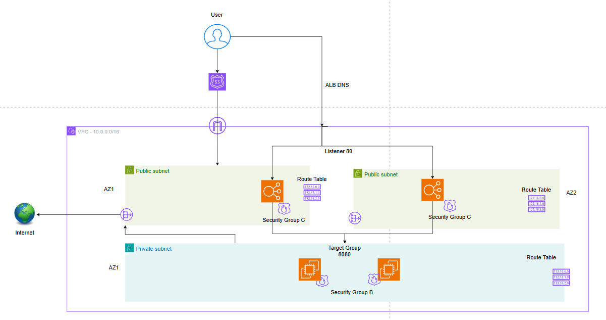
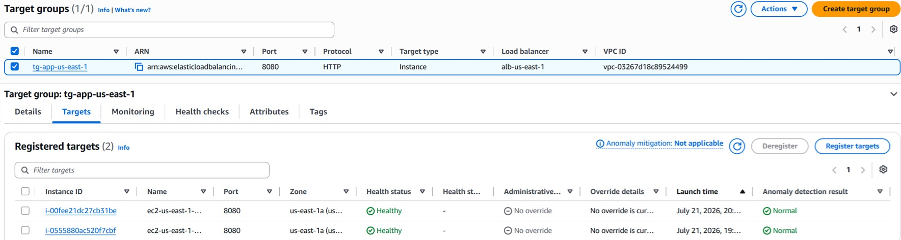
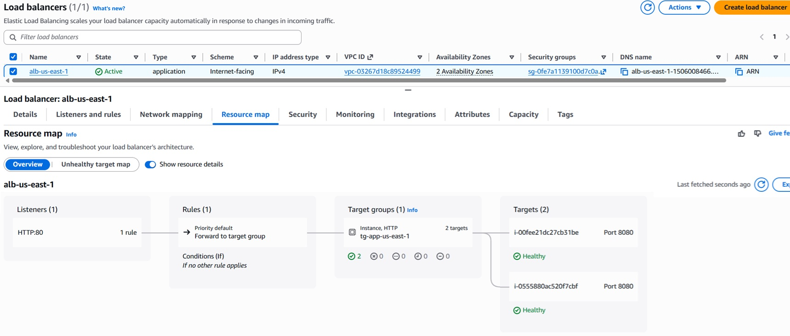

<p align="left">
  
</p>

Application Load Balancer Task - (Based on Previous VPC Task)
------------------------------
1. Create Another Public Subnet using Differents AZ`s
2. Attach New Subnet to Public Route Table (with NAT Assosiate)
3. Create Security Group for EC2
4. Create EC2 without Public IP (using private subnet)
5. install NodeJs using NAT Gateway
6. Deploy show_private_ip Code using NodeJs
7. Verify Your Code using CURL Command Between 2 instances
------------------------------
8. Create Target Group Based EC2 Instances
9. Heath Check "/"
10. Create Security Group for ALB
11. Create Load Balancer with Public IP/DNS (using Public Subnet)
12. Attach Target Group to Application Load Balancer
13. Verify ALB Traffic between 2 instances
------------------------------
14. Bonus: Add Route53 Record | /etc/hosts - for local dns


#### Create Another Public Subnet using Differents AZ`s
```
VPC -> Subnets -> Create subnet
# public subnet #
VPC ID: Create subnets in this VPC -> vpc-us-east-1
Subnet name: public-snet-us-east-1b
Availability Zone: United States (N. Virginia) / use1-az1 (us-east-1b)
IPv4 CIDR: 10.0.3.0/25
```
#### Attach New Subnet to Public Route Table (without NAT Assosiate)
```
VPC -> Route tables -> rtb-0f269baa0a2032f37 -> Edit subnet associations 
[v] public-snet-us-east-1b
```
#### Create Security Group for EC2
```
EC2 -> Security Groups -> Create security group
Security group name: app-sg-us-east-1-lab02
VPC: vpc-03267d18c89524499 | vpc-us-east-1
Inbound rules -> Edit inbound rules:       (Type: SSH, Source: Anywhere IPv4 0.0.0.0/0)  -  SSH port from all
                                           (Type: Custom TCP, Port range: 8080, Source: Custom alb-sg-us-east-1-lab02)  -  app port
```
#### Create 2 EC2 without Public IP (using private subnet)
```
Must be at least 2 instances
# APP #
Name: ec2-us-east-1-lab02-app1   &   ec2-us-east-1-lab02-app2
Application and OS Images: Ubuntu
Instance type: t3.small
Key pair (login): aws-ssh-key  - already existing
Network settings:
    VPC: vpc-us-east-1
    Subnet: private-snet-us-east-1a
    Auto-assign public IP: Enable
    Firewall (security groups): [v] Select existing security group -> app-sg-us-east-1-lab02
```
#### install NodeJs using NAT Gateway
```
# Login to ec2-xx-app via jumping from public app (public IP) ## 
ssh -o ProxyCommand="ssh -i ./aws-ssh-key.pem -W %h:%p ubuntu@3.237.92.162" -i ./aws-ssh-key.pem ubuntu@10.0.2.195

ssh -o ProxyCommand="ssh -i ./aws-ssh-key.pem -W %h:%p ubuntu@3.237.92.162" -i ./aws-ssh-key.pem ubuntu@10.0.2.6

curl -fsSL https://deb.nodesource.com/setup_18.x | sudo bash -
sudo apt install -y nodejs
```
#### Deploy show_private_ip Code using NodeJs
```
mkdir app
cd app
nano server.js
nano package.json
nano package-lock.json

npm install
nohup node server.js > logfile.log 2>&1 &
ps aux | grep node
```
#### Verify Your Code using CURL Command Between 2 instances
```
ssh -o ProxyCommand="ssh -i ./aws-ssh-key.pem -W %h:%p ubuntu@3.237.92.162" -i ./aws-ssh-key.pem ubuntu@10.0.2.195
curl 10.0.2.6:8080

ssh -o ProxyCommand="ssh -i ./aws-ssh-key.pem -W %h:%p ubuntu@3.237.92.162" -i ./aws-ssh-key.pem ubuntu@10.0.2.6
curl 10.0.2.195:8080
```
#### Create Target Group Based EC2 Instances
```
EC2 -> Target groups -> Create target group
Target type: Instances
Target group name: tg-app-us-east-1
Protocol: HTTP
Port: 8080
VPC:  vpc-03267d18c89524499 (vpc-us-east-1)
```
<p align="left">
  
</p>

#### Health checks 
```
Health check protocol: HTTP
Health check path: "/"
Next

Register targets: [v] ec2-us-east-1-lab02-app2  [v] ec2-us-east-1-lab02-app1
Click on: Include as pending below
Create target group
Unsed state
```
#### Create Security Group for ALB
```
Security group name: alb-sg-us-east-1-lab02
VPC: vpc-03267d18c89524499 (vpc-us-east-1)
Inbound rules -> Edit inbound rules:       (Type: SSH, Source: Anywhere IPv4 0.0.0.0/0)  -  SSH port from all
                                           (Type: Custom TCP, Port range: 80, Source: Anywhere IPv4 0.0.0.0/0)  -  app port
```
#### Create Load Balancer with Public IP/DNS (using Public Subnet)
```
!!!  Must be at least 2 Availability zone  !!!
EC2 -> Load balancers -> Compare and select load balancer type
Application Load Balancer -> Create
Load balancer name: alb-us-east-1
Scheme: Internet-facing
VPC:  vpc-03267d18c89524499 (vpc-us-east-1)
Availability Zones and subnets:
[v] us-east-1a (use1-az1) 
    Subnet [v] subnet-04ec1042116d36817 (public-snet-us-east-1a)
[v] us-east-1b (use1-az2)
    Subnet [v] subnet-0f4fcbc48df4be33e (public-snet-us-east-1b)
Security groups: alb-sg-us-east-1-lab02 (sg-0fe7a1139100d7c0a)
Listeners and routing: Listener HTTP:80
## Attach Target Group to Application Load Balancer
Target group: tg-app-us-east-1
Create Load Balancer
```
<p align="left">
  
</p>

## Verify ALB Traffic between 2 instances
```
http://alb-us-east-1-1506008466.us-east-1.elb.amazonaws.com/
Hello World!
Instance IP: 10.0.2.195
http://alb-us-east-1-1506008466.us-east-1.elb.amazonaws.com/
Hello World!
Instance IP: 10.0.2.6
```