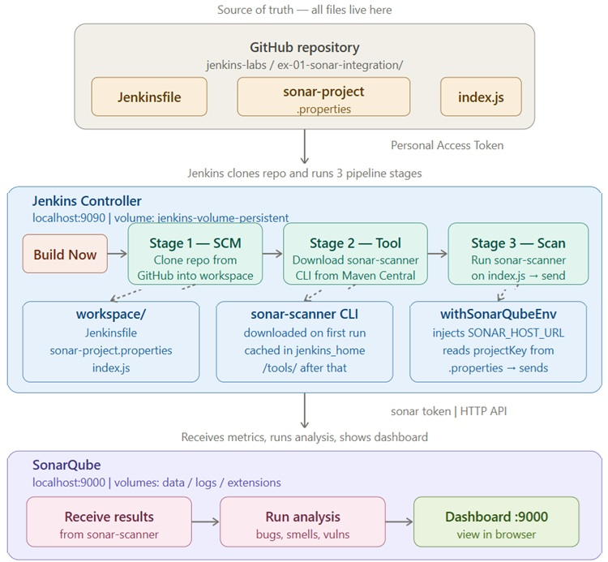

## Jenkins and SonarQube integration

<p align="left">
  
</p>

### Part 1: Setup Your Environment
#### GitHub → Settings → Developer Settings
```
Repository : (sonar-integration)
Personal access tokens → Fine-grained tokens
  ↓
Generate new token
Fill in:
- Token name: jenkins-token
- Expiration: select a period
- Resource owner: your account
- Repository access: Only select repositories → select specific repository

Repository permissions:
- Contents → Read and Write
- Metadata → Read-only (set automatically)
```

#### Deploy Jenkins via Docker
```
docker volume create jenkins-volume-persistent

docker run --name jenkins -d -p 3000:3000 -p 9090:8080 -p 50000:50000 -v \
 jenkins-volume-persistent:/var/jenkins_home jenkins/jenkins:lts
```
URL: http://localhost:9090  
username&passw amin/admin  

#### Integrate Git with Jenkins
```
Dashboard → Manage Jenkins → Credentials  
  ↓  
System → Global credentials → Add Credentials -> (jenkins_git_cred)  
Fill in:  
- Kind: Username with password
- Username: your GitHub username
- Password: your Personal Access Token (which you created earlier)
- ID: github-credentials  
Save
```
#### Add Sample Code  
Create a new file (index.js) inside (your) repository.  

#### Configure SonarQube Plugin in Jenkins
```
Jenkins -> Manage Jenkins -> Plugins  
search and install - (SonarQube Scanner for Jenkins)  
Jenkins -> Manage Jenkins -> Tools   
find `SonarQube Scanner installations` -> Add SonarQube Scanner  
Fill in:  
- Name: sonar_scanner_tool  
- Version: some latest version  
```

### Part 2: Deploy and Configure SonarQube
#### Deploy SonarQube via Docker
URL source: https://hub.docker.com/_/sonarqube  
Doc: https://docs.sonarsource.com/sonarqube-server/2025.6/analyzing-source-code/ci-integration/jenkins-integration/global-setup
```
docker volume create sonarqube-data-persistent
docker volume create sonarqube-logs-persistent
docker volume create sonarqube-extensions-persistent

docker run --name sonarqube-custom -p 9000:9000 \
      -v sonarqube-data-persistent:/opt/sonarqube/data \
      -v sonarqube-logs-persistent:/opt/sonarqube/logs \
      -v sonarqube-extensions-persistent:/opt/sonarqube/extensions \
                                                            sonarqube
```
URL: http://localhost:9000   
default: admin/admin  
admin/11qaZZ@@wsxx  

#### Create a New Project in SonarQube
```
Create a local project: (sonarqube_project_for_jenkins)  
Analysis Method: With Jenkins  
Select your DevOps platform: GitHub 
2. 
3. !Skip! creating a GitHub webhook — we will use a manual pipeline "Build Now".  
4. Create a Jenkinsfile
- Other  
- Create a sonar-project.properties file in your repository and paste the following code: sonar.projectKey=sonarqube_project_for_jenkins  
- Create a Jenkinsfile file in your repository
```
#### Jenkinsfile 
Important:  
<server or instance name> - the name configured in Jenkins  
-Dsonar.projectBaseDir=<location path from /> - Specify where to look for sonar-project.properties  
```
node {
  stage('SCM') {
    checkout scm
  }
  stage('Show files, PWD') {
    sh "ls -la"
    sh "pwd"
  }
  stage('SonarQube Analysis') {
    def scannerHome = tool 'sonar_scanner_tool';
    // sonar_instance - the name configured in Jenkins
    withSonarQubeEnv('sonar_instance') {
      // Default location of sonar-project.properties
      // sh "${scannerHome}/bin/sonar-scanner"
      
      // Specify where to look for sonar-project.properties
      sh "${scannerHome}/bin/sonar-scanner -Dsonar.projectBaseDir=ex-01-sonar-integration"
    }
  }
}
```


#### Secret: Generate a token in SonarQube 
```
A (My Account) > Security > Generate Tokens  
Fill in:  
- Name: sonar_token_for_jenkins
- Type: Project Analysis Token
Secret: [COPY]-Secret  
```
#### Integrate SonarQube with Jenkins
```
Dashboard > Credentials > System > Global > Add Credentials > Secret Text  
Fill in:  
- Scope: Global  
- Secret: [PAST]-Secret  
- ID: (sonar-jenkins-cred)  

Dashboard > Manage Jenkins > System   
From the SonarQube Servers section, click Add SonarQube.  
Fill in:  
Name: (sonar_instance) - Give a unique name to your SonarQube Server instance.  
Server URL: (http://172.17.0.3:9000) IP SonarQube Server - check: <docker inspect -f '{{range .NetworkSettings.Networks}}{{.IPAddress}}{{end}}' sonarqube-custom>  
Credentials: (sonar-jenkins-cred)  
```
### Part 3: Analyze Your Code
#### Create Jenkins Pipeline for SonarScanner
pipeline jenkins-sonar-pipeline     
```
Dashboard → jenkins-sonar-pipeline → Configure   
  ↓  
Pipeline → Definition → Pipeline script from SCM   
Fill:  
- SCM → Git  
- Repository URL → https://github.com/your-username/your-repo.git  
- Credentials → select jenkins_git_cred  
- Branch → */main  
- Script Path → ex-01-sonar-integration/Jenkinsfile  
```


