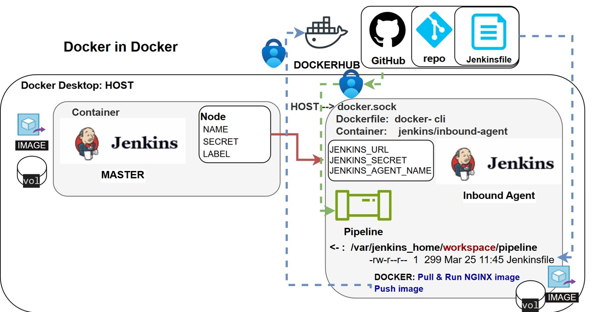

## Jenkins Launch 'Inbound Agent' by connecting it to the controller

<p align="left">
  
</p>

1. Create Dockerfile based on Inbound Agent with DIND (Docker in Docker)
2. Create & Configure new Inbound Agent 'Docker-Agent' in Jenkins
3. Create Jenkins Pipeline That Using Your Inbound Agent 'Slave':
    - Pull NGINX image
    - Run as Container
    - using port 8000
4. Testing in your host localhost:8000
5. Push your Dockerfile to your Public Registry - DockerHub  

#### Note:
We will share this daemon from HOST to our Docker container.  
docker.sock is the UNIX socket that Docker daemon is listening to.  
-v /var/run/docker.sock:/var/run/docker.sock    # In the contaniner
windows  
660 root:root rw-rw-xxx /var/run/docker.sock  
option 1: add jenkins to root group option 2: 666, 667 -> rw-rw-rw-  

### Part 1.
#### create volume, and Jenkins master
```
docker volume create docker-jenkins-agent-volume

docker run --name jenkins -d -p 3000:3000 -p 9090:8080 -p 50000:50000 -v \
    jenkins-volume-persistent:/var/jenkins_home jenkins/jenkins:lts
```
#### create Dockerfile based on Inbound Agent with DIND
Use docker image:  https://hub.docker.com/r/jenkins/inbound-agent  

### Part 2.
#### create & Configure new Inbound Agent 'Docker-Agent' in Jenkins
```
Create Node: Jenkins > Nodes > New Node
Jenkins > Nodes > dind-inbound-agent-slave > Configure
Fill:
- Name: dind-inbound-agent-slave  
- Remote root directory: /home/jenkins  
- Labels: docker-inbound-agent-label  
- Launch method: Launch agent by connecting it to the controller  
Take the secret: secret dd2c4933a6784396.x.x.xx..x.xx.x.x.x.  
```
#### build image
```
docker build -t dind-inbound-agent-img \
      -f ex-03-docker-inbound-agent/Dockerfile .
```
#### run container from created image
```
docker run -d \
  --privileged \
  --name dind-inbound-jenkins-agent \
  -e JENKINS_URL=http://172.17.0.2:8080 \
  -e JENKINS_SECRET=dd2c4933a678439601c5646ae336969986da34c3ee2221c5615c0477d40c0ba5 \
  -e JENKINS_AGENT_NAME=dind-inbound-agent-slave \
  -v docker-jenkins-agent-volume:/home/jenkins \
  -v /var/run/docker.sock:/var/run/docker.sock \
  dind-inbound-agent-img
```
### Part 3.
#### Create Jenkins Pipeline That Using Your Inbound Agent 'Slave':
```
Definition: Pipeline script from SCM
- SCM: Git
- Connect Jenkins to GitHub: https://github.com/evgeny-kor-m/jenkins-labs.git  
- Branch Specifier: */main  
- Use existing (PAT): (jenkins_git_cred)  
- Script Path: ex-03-docker-inbound-agent/Jenkinsfile  
Create the Jenkinsfile  
```
#### Testing in your host localhost:8000
curl http://localhost:8000/  

### Part 4.
### Push your Dockerfile to your Public Registry - DockerHub
#### Create token in DockerHub:  
Account settings > Generate new token > Personal access tokens > Create access token  
#1 - jenkins-dockerhub-pat  
#2 - read / write
#### Add DockerHub credentials to Jenkins
```
Dashboard → Manage Jenkins → Credentials
  ↓
System → Global credentials → Add Credentials
Fill in:
- Kind: Username with password
- Username: your DockerHub username
- Password: your Personal Access Token (which you created earlier)
- ID: DockerHub-cred
Save
```
#### Save username & DockerHub token in Jenkins credentials
```
docker login -u evg..........  
dckr_pat_wQuXP..............  
create: DOCKERHUB-CRED
```
#### Add to Jenkinsfile using DockerHub credentials
sh 'echo "$DOCKERHUB_PSW" | docker login -u "$DOCKERHUB_USR" --password-stdin'
```
DOCKERHUB-CRED

        environment {
             DOCKERHUB_CREDENTIALS = credentials('DOCKERHUB-CRED')    }
```
Print parameters
```
        stage('Print PAT username') {
            steps {
                sh 'echo "GitHub username: $DOCKERHUB_CREDENTIALS_USR"'
                sh 'echo "GitHub password: $DOCKERHUB_CREDENTIALS_PSW"'  }}