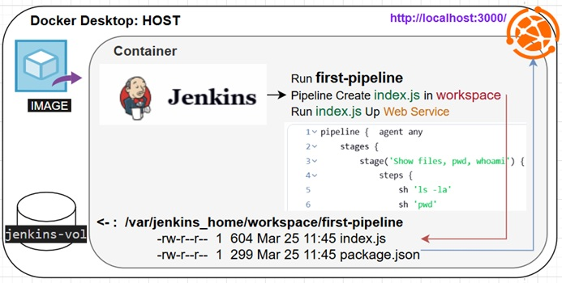
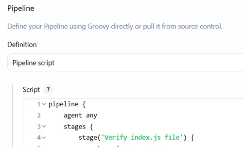

# Jenkins pipeline with Nodejs local installation 

<p align="left">
  
</p>

init, connect volume, create user/pass, check
```
docker volume create jenkins-vol

docker run --name jenkins -d -p 3000:3000 -p 8080:8080 -p 50000:50000 \
 -v jenkins-vol:/var/jenkins_home jenkins/jenkins:lts
```
URL: http://localhost:8080
```
docker exec jenkins cat /var/jenkins_home/secrets/initialAdminPassword
```
create username: admin and password: admin  
check:
```
docker exec -it jenkins bash
jenkins@dac570126237:/$ whoami
jenkins
```
create pipeline  
New Item -> pipeline -> first-pipeline  
<p align="left">
  
</p>
<!--  -->  

```
pipeline {
    agent any
    stages {
        stage('Show files, pwd, whoami') {
            steps {
                sh 'ls -la'
                sh 'pwd'
                sh 'whoami'    }      }
    }
}
```
Run  
Take work directory path (pwd):  /var/jenkins_home/workspace/first-pipeline  
install in jenkins container Nodejs and his dependency  

as user root install nodejs
```
docker exec -it --user root jenkins bash
apt-get install -y nodejs vim
```
as user jenkins create 'package.json' and download 'node_modules' for express
```
docker exec -it jenkins bash
cd /var/jenkins_home/workspace/first-pipeline
npm init -y
npm i express
```
add moer stages in pipeline:
```
        stage('Node version') {
            steps {
                sh 'node -v'
                sh 'npm -v'           }}
        stage('Create index.js') {
            steps {
                writeFile file: 'index.js', text: '''
                                const express = require('express')
                                const app = express()
                                const port = 3000
                                
                                app.get('/', (req, res) => {
                                  res.send('Hello World!')
                                })
                                
                                app.listen(port, () => {
                                  console.log(`Example app listening on port ${port}`)
                                })
                                '''
        }}        
        stage('Run index.js') {
            steps {
                sh 'node index.js'        }}
```
Run -> [Build Now]  
pipeline inside ths jenkins container will create index.js file and run it.
workspace:
```
jenkins@dac570126237:~$ ls -la /var/jenkins_home/workspace/first-pipeline
total 52
drwxr-xr-x  3 jenkins jenkins  4096 Mar 25 14:48 .
drwxr-xr-x 14 jenkins jenkins  4096 Mar 20 09:25 ..
-rw-r--r--  1 jenkins jenkins   604 Mar 25 14:48 index.js
drwxr-xr-x 67 jenkins jenkins  4096 Mar 25 14:39 node_modules
-rw-r--r--  1 jenkins jenkins 28939 Mar 25 14:39 package-lock.json
-rw-r--r--  1 jenkins jenkins   277 Mar 25 14:39 package.json
```