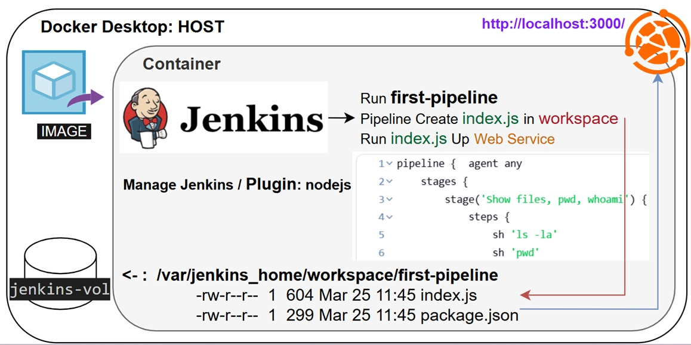
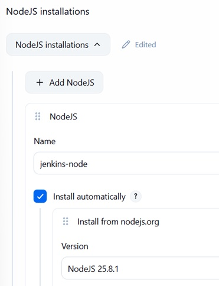

## Jenkins Pipeline, use Nodejs plugin & tool

<p align="left">
  
</p>

1. deploy jenkins as docker with volume
2. install node plugin
3. create new pipeline that running index.js (node -v, npm -v, npm init -y, npm install express, node index.js)

### init, connect volume, create user/pass, check
```
docker volume create jenkins-vol

docker run --name jenkins -d -p 3000:3000 -p 8080:8080 -p 50000:50000 \
 -v jenkins-vol:/var/jenkins_home jenkins/jenkins:lts
```
URL: http://localhost:8080
```
docker exec jenkins cat /var/jenkins_home/secrets/initialAdminPassword
```
create username: admin and password: admin  
check:
```
docker exec -it jenkins bash
jenkins@dac570126237:/$ whoami
jenkins
```
### Configure plugin:  
Jenkins -> Manage Jenkins -> Plugins  
search and install - NodeJS Plugin  

Jenkins -> Manage Jenkins -> Tools  
find `NodeJS installations` -> Add NodeJS
Fill in:
- Name: jenkins-node
- Version: some latest version

<p align="left">
  
</p>

install in jenkins container dependency  for Nodejs tool
```
docker exec -it --user root jenkins bash
apt-get update && apt-get install -y libatomic1
```
### create pipeline  
New Item -> pipeline -> jenkins-pipeline  
```
pipeline {
    agent any
```
Add nodejs tool into pipeline:  
```
    tools {
        nodejs 'jenkins-node'
    }
```
```
    stages {
        stage('Show files, pwd, who I`am') {
            steps {
                sh 'ls -la'
                sh 'pwd'
                sh 'whoami'
            }
        }
        stage('Node version') {
            steps {
                sh 'node -v'
                sh 'npm -v'
            }
        }
        stage('Init project') {
            steps {
                sh 'npm init -y'
            }
        }
        stage('Install Express') {
            steps {
                sh 'npm install express'
            }
        }
        stage('Create index.js') {
            steps {
                writeFile file: 'index.js', text: '''
                                const express = require('express')
                                const app = express()
                                const port = 3000
                                
                                app.get('/', (req, res) => {
                                  res.send('Hello World!')
                                })
                                
                                app.listen(port, () => {
                                  console.log(`Example app listening on port ${port}`)
                                })
                                '''
            }
        }        
        stage('Run index.js') {
            steps {
                sh 'node index.js'
            }
        }
    }
}
```


### Console Output:  
use Nodejs version of tool `jenkins-node`
```
[Pipeline] sh
+ node -v
v25.8.1
[Pipeline] sh
+ npm -v
11.11.0
```