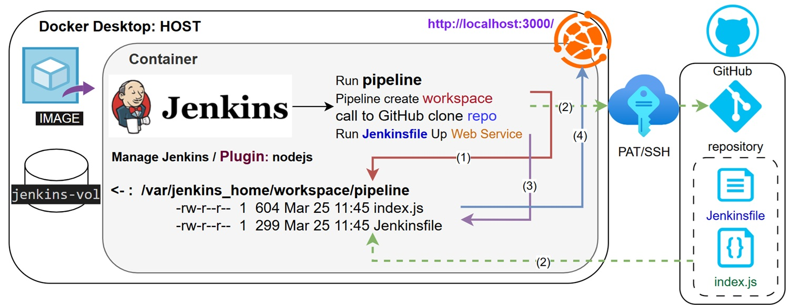

<p align="left">
  
</p>

### PAT to GitHub , Jenkins configuration settings
1. change the visibility of github repo to private
2. create new PAT
3. create new jenkins cred for PAT
4. attach jenkins credentials to new pipeline using SCM
5. create jenkinsfile
6. use ENV to print PAT username
7. run nodejs application using index.js that locate on github

#### Create Jenkinsfile,index.js and add to the repository
ndex_on_github.js  
Jenkinsfile-pat-env:  
```
pipeline {
    agent any
    tools {      
        nodejs 'jenkins-node'     }
```
Add environment section to fetch credentials values
```
        environment {
             GIT_CREDENTIALS = credentials('github-credentials')    }
```
Print parameters
```
        stage('Print PAT username') {
            steps {
                sh 'echo "GitHub username: $GIT_CREDENTIALS_USR"'
                sh 'echo "GitHub password: $GIT_CREDENTIALS_PSW"'  }}
```

#### GitHub → Settings → Developer Settings
```
Personal access tokens → Fine-grained tokens
  ↓
Generate new token
Fill in:
- Token name: jenkins-token
- Expiration: select a period
- Resource owner: your account
- Repository access: Only select repositories → select jenkins-labs

Repository permissions:
- Contents → Read and Write
- Metadata → Read-only (set automatically)
```
#### Add credentials to Jenkins
```
Dashboard → Manage Jenkins → Credentials
  ↓
System → Global credentials → Add Credentials
Fill in:
- Kind: Username with password
- Username: your GitHub username
- Password: your Personal Access Token (which you created earlier)
- ID: github-credentials
Save
```
#### Configure the Job in Jenkins
pipeline env-pat2git-pipeline   
```
Dashboard → env-pat2git-pipeline → Configure
  ↓
Pipeline → Definition → Pipeline script from SCM
Fill:
- SCM → Git
- Repository URL → https://github.com/your-username/your-repo.git
- Credentials → select github-credentials
- Branch → */main
- Script Path → lab-03-credential-env/Jenkinsfile-pat-env
```
### SSH to GitHub , Jenkins configuration settings
1. change the visibility of github repo to private
2. create new SSH keys
3. create new jenkins credentials for SSH
4. attach jenkins cred to new pipeline using SCM
5. create jenkins file
6. use ENV to print SSH key
7. run nodejs application using index.js that locate on github

#### Preparing key
```
mkdir ~/.ssh_key
ssh-keygen -t ed25519 -C "jenkins-github-access" -f ~/.ssh_key/github_access_key -N ""
mv ~/.ssh_key/github_access_key ~/.ssh_key/id_ed25519
```
#### Adding PUBLIC key to GitHub 
```
GitHub → jenkins-labs repository → Settings → Settings → Deploy keys
↓
Add deploy key
↓
Title: jenkins-ssh-key
Key: paste the contents of the PUBLIC key (id_ed25519.pub)
Allow write access: V (if push is needed)
↓
Add key
```
#### Create credentials on Jenkins and add private key
```
Manage Jenkins → Credentials → Global → Add Credentials
↓
Kind: SSH Username with private key
ID: jenkins-ssh-key
Username: git           ← Important! For GitHub, always "git"
Private Key → Enter directly → Paste your private key
↓
Create
```
#### You need to add GitHub to known_hosts
```
via the Jenkins UI (or with a container):

Manage Jenkins → Security → Git Host Key Verification Configuration
↓
Host Key Verification Strategy
↓
Accept first connection
↓
Save
```
#### Configure the Job in Jenkins
pipeline env-ssh2git-pipeline   
```
Dashboard → env-pat2git-pipeline → Configure
  ↓
Pipeline → Definition → Pipeline script from SCM
Fill:
- SCM → Git
- Repository URL → git@github.com/{your-username}/{your-repo}.git
- Credentials → select github-credentials
- Branch → */main
- Script Path → lab-03-credential-env/Jenkinsfile-ssh-env
```
#### Create Jenkinsfile,index.js and add to the repository
ndex_on_github.js  
Jenkinsfile-ssh-env: 
```
pipeline {
    agent any
    tools {
            nodejs 'jenkins-node'  }
```
Add environment section to fetch credentials values
```
    environment {
        SSH_KEY = credentials('jenkins-github-ssh-cred')   }
```
Print parameters
```
    stages {
        stage('Print SSH username') {
            steps {
                sh 'echo "SSH username: $SSH_KEY_USR"'
            }
        }
```

