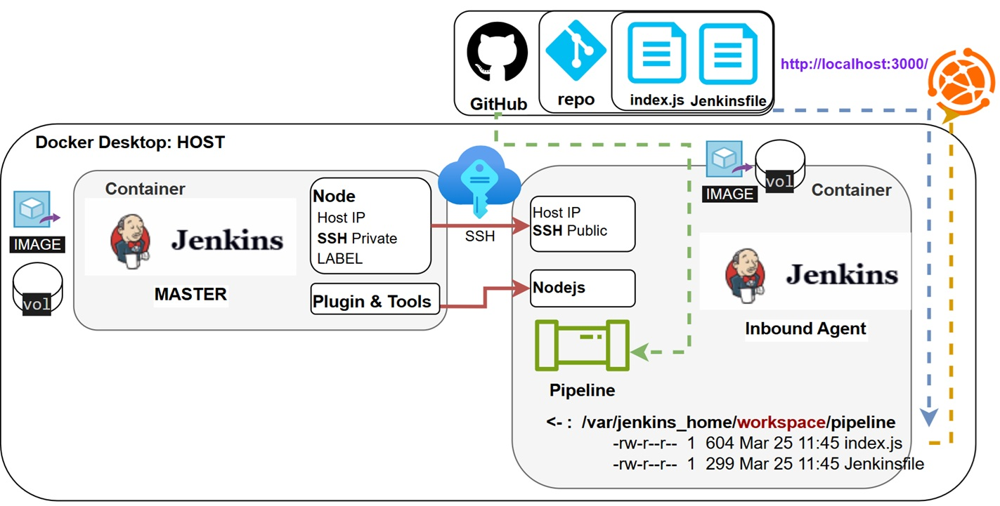

## Jenkins MASTER Run on AGENT by SSH

<p align="left">
  
</p>

1. Configure Alpine With SSHD Online - extra installation of git & openjdk17
2. Expose The Private Key & Test Connection
3. Configure New Node in Jenkins
4. Pipeline & Jenkinsfile
5. Use nodejs plugin & tool

#### Prerequisites:
```
docker volume create jenkins-volume-persistent

docker run --name jenkins -d -p 3000:3000 -p 9090:8080 -p 50000:50000 -v \
 jenkins-volume-persistent:/var/jenkins_home jenkins/jenkins:lts  
```
### Part 1.
Clean known_hosts file and run container based on alpine:latest:  
```
ssh-keygen -R "[localhost]:2222"
docker run -d --name simple-alpine-slave -p 2222:22 alpine:latest sleep infinity
```
Enter to container, generate host key, create & configure user:  
```
docker exec -it simple-alpine-slave sh  
apk add openssh nano openjdk17 git  
ssh-keygen -A  
echo PubkeyAuthentication yes >> /etc/ssh/sshd_config  
echo PasswordAuthentication yes >> /etc/ssh/sshd_config  
adduser jenkins      # pass: 123
/usr/sbin/sshd  
netstat -tlnp | grep :22  
exit
```
Login as jenkins user jenkins:  
```
docker exec -it simple-alpine-slave su - jenkins  
docker exec -it --user jenkins simple-alpine-slave
```
Generate ssh-key:   
```
ssh-keygen -t rsa -b 4096 -f ~/.ssh/id_rsa -N ""  
mv .ssh/id_rsa.pub .ssh/authorized_keys  
cat .ssh/authorized_keys  
exit 
```
### Part 2. 
#### Expose The Private Key & Test Connection
```
docker cp simple-alpine-slave:/home/jenkins/.ssh/id_rsa ./id_rsa  
ssh -i .\id_rsa -p 2222 jenkins@localhost  
exit
```
### Part 3.
#### Configure New Node in Jenkins
Fill:
- Name: ssh-jenkins-agent-slave
- Remote root directory: /home/jenkins 
- Lables: (ssh-agent-pipeline-label)
- Method: Lunch agents via SSH
    - Host: <docker inspect simple-alpine-slave = ip address (172.17.0.6)>
    - Credentials: 
        - Add SSH Username with private key
        - ID: SSH_KEY_4_AGENT_SLAVE
        - Username: jenkins
        - Private Key > Enter directly:  <Past privet key from step 2>
    - Non verifying Verification Strategy
Save  

#### Note: Logs in case of errors:
In the case we see fail after save, check in: Jenkins > Nodes > ssh-jenkins-agent-slave > Log  

#### Note: must define agent label:
#- Run on a specific agent by label  
    agent { label 'ssh-slave-label' }  
#- Run on any available agent   
    agent any  
#- Run on the controller itself (not recommended)  
    agent none  

Example Jenkinsfile:  
```
pipeline {
    agent { label 'ssh-agent-pipeline-label' }
    stages {
        stage('my home directory') {
            steps {
                sh "pwd"
            }
        }
    }
}
```

### Part 4.
#### Create Jenkins Pipeline That Using Your SSH Agent 'Slave':
Create pipeline: ssh-agent-pipeline  
- Definition: Pipeline script from SCM
- SCM: Git
- Connect Jenkins to GitHub: https://github.com/evgeny-kor-m/jenkins-labs.git  
- Branch Specifier: */main  
- Use existing (PAT): (jenkins_git_cred)  
- Script Path: lab-04-jenkins-ssh-slave/Jenkinsfile  
Create the Jenkinsfile  

### Part 5.
#### Configure plugin & Tool:  
Jenkins -> Manage Jenkins -> Plugins  
search and install - NodeJS Plugin  

Jenkins -> Manage Jenkins -> Tools  
find `NodeJS installations` -> Add NodeJS
Fill in:
- Name: jenkins-node
- Version: some latest version

#### Add to Jenkinsfile:
stage 1 -> git clone - by default  
stage 2 -> npm init -y  
stage 3 -> npm install express  
stage 4 -> node index.js  
