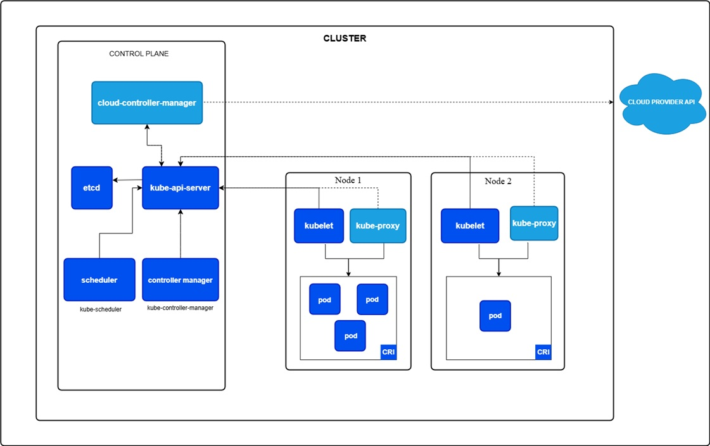

# kubernetes

  

# Kubernetes Architecture — Cheat Sheet

## Control Plane Components
Make global decisions: scheduling, detecting and responding to cluster events

### kube-apiserver
- Front end of the control plane
- Exposes Kubernetes API
- Scales horizontally (multiple instances)

### etcd
- Key-value store for all cluster data
- Highly available and consistent
- Always have a backup plan!

### kube-scheduler
- Watches for new Pods with no assigned node
- Selects best node based on:
  - Resource requirements
  - Hardware/software constraints
  - Affinity/anti-affinity rules
  - Data locality, deadlines

### kube-controller-manager
- Runs all controller processes in a single binary
- Controllers:
  - Node controller      → handles node failures
  - Job controller       → runs one-off tasks
  - EndpointSlice ctrl   → links Services to Pods
  - ServiceAccount ctrl  → creates default accounts

### cloud-controller-manager
- Links cluster to cloud provider API
- Only runs in cloud environments (not on local/on-premise)
- Controllers:
  - Node controller    → checks deleted cloud nodes
  - Route controller   → manages cloud routing
  - Service controller → manages load balancers

---

## Node Components
Run on every node, maintain Pods and provide runtime environment

### kubelet
- Agent running on each node
- Ensures containers are running and healthy
- Only manages containers created by Kubernetes

### kube-proxy (optional)
- Network proxy on each node
- Maintains network rules for Pod communication
- Not needed if CNI plugin handles packet forwarding

### Container Runtime
- Manages execution and lifecycle of containers
- Supported: containerd, CRI-O, any CRI implementation

---

## Addons
Cluster-level features, live in kube-system namespace

- DNS                  → DNS server for Kubernetes services, auto-included in all containers
- Dashboard (Web UI)   → Web-based UI for cluster management
- Resource Monitoring  → Time-series metrics for containers
- Cluster Logging      → Central log store for containers
- Network Plugins(CNI) → Allocate IPs to Pods, enable Pod-to-Pod communication

---

## Control Plane Deployment Options

- Traditional   → Components run as systemd services on dedicated VMs
- Static Pods   → Components run as Pods managed by kubelet (used by kubeadm)
- Self-hosted   → Components run as Deployments/StatefulSets inside the cluster
- Managed Cloud → Cloud provider manages control plane (EKS, GKE, AKS)

---

## Quick Summary

- Control Plane  → Brain of the cluster (scheduling, decisions, state)
- Node           → Worker (runs Pods, maintains containers)
- etcd           → Memory of the cluster (stores all state)
- kubelet        → Node agent (ensures Pods are running)
- kube-proxy     → Network rules on each node
- CNI Plugin     → Pod networking and IP allocation