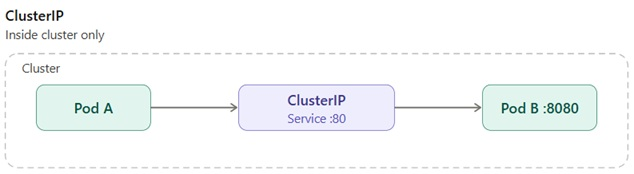
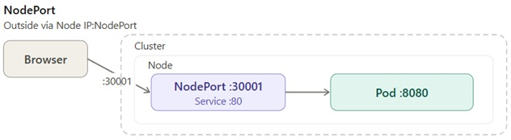
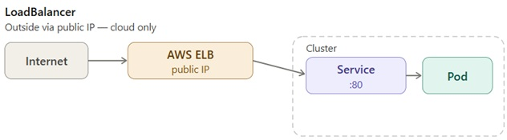
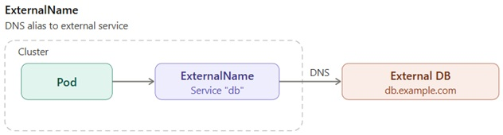

# Kubernetes Service Types

Four types of Kubernetes Service — ways to expose access to Pods.  
```
Type          | Access                        | Use case
---------------------------------------------------------------
ClusterIP     | Inside cluster only           | Microservices  
NodePort      | Outside via Node IP           | Dev/Test  
LoadBalancer  | Outside via public IP         | Production/Cloud  
ExternalName  | External DNS                  | External services  
```
---

## ClusterIP (default)
<p align="left">
  
</p>

- Accessible only inside the cluster
- Gives Pods a stable internal IP
- Used for communication between microservices
```
spec:
  type: ClusterIP
  ports:
  - port: 80        # Service port inside the cluster
                    # other Pods talk to Service on this port
    targetPort: 8080 # container port inside the Pod
                    # Service forwards traffic here

Pod A  →  ClusterIP Service  →  Pod B
(inside cluster only, not accessible from outside)
```
---

## NodePort
<p align="left">
  
</p>

- Opens a port on every Node in the cluster
- Accessible from outside via <NodeIP>:<NodePort>
- Port range: 30000-32767
- Used for development and testing
```
spec:
  type: NodePort
  ports:
  - port: 80        # Service port inside the cluster
                    # other Pods talk to Service on this port
    targetPort: 8080 # container port inside the Pod
                    # Service forwards traffic here
    nodePort: 30001  # port opened on every Node
                    # external access: <NodeIP>:30001

Browser → NodeIP:30001 → Service:80 → Pod:8080
          (nodePort)      (port)       (targetPort)
```
Chain: curl http://localhost:30001
<Node-IP>:<Node-Port>
```
Browser/curl localhost:30001
        ↓
WSL localhost:30001
        ↓
extraPortMappings (hostPort:30001 → containerPort:30001)
        ↓
kind-worker container port 30001
        ↓
Kubernetes NodePort Service :30001
        ↓
Pod
```
---

## LoadBalancer
<p align="left">
  
</p>

- Creates an external Load Balancer at the cloud provider
- Automatically gets a public IP
- Used in production on AWS/GCP/Azure
- Includes ClusterIP and NodePort internally
```
spec:
  type: LoadBalancer
  ports:
  - port: 80        # Service port inside the cluster
    targetPort: 8080 # container port inside the Pod

Internet → AWS ELB (public IP) → Service:80 → Pod:8080
                                  (port)       (targetPort)
```
---

## ExternalName
<p align="left">
  
</p>

- Does not create a real proxy
- Simply returns a DNS name of an external service
- Used to access external services by name from inside the cluster
```
spec:
  type: ExternalName
  externalName: my-database.example.com

Pod → Service "db" → my-database.example.com
```

---
# Service type of ClusterIP ( Internal IP ) example
- Cleanup if needed
- Create pod and expose svc type of ClusterIP (Default), Based on example-pod of lab-01​
- Exposes the service only within the cluster​
- login internally to my-clusterip-service.yml inside pod and via port forwarding

```
kubectl get all
kubectl config set-context --current --namespace=ns-my-first-pod
kubectl get pod
kubectl get rs
kubectl delete pod example-pod
 or
kubectl edit rs example-pod                                  # pod delete if needed  rs = 0
 or
kubectl delete pod example-pod --force --grace-period=0      # Force delete
kubectl get pod
  kubectl get pods --all-namespaces
kubectl get svc
kubectl delete svc my-clusterip-service
kubectl apply -f my-first-pod.yaml
kubectl get pod
```
```
kubectl expose pod example-pod \
  --name=my-clusterip-service \
  --port=80 \
  --target-port=80 \
  --type=ClusterIP
```

```
kubectl get pod
kubectl get rs
kubectl get svc
kubectl get all

# Test, lets go into example-pod
kubectl exec -it example-pod -- sh
curl http://my-clusterip-service
  # Output is internally the nginx page
```

- Run the my-pod-rs-svc.yaml file
- Check with describe command the Service type

```
kubectl apply -f my-pod-rs-svc.yaml

```

### NodePort dogs-cats example 
```
kubectl apply -f dogs-cats.yaml
kubectl get all
kubectl get nodes -o wide
kind get clusters
kubectl config get-contexts
kubectl get svc
kubectl describe svc cats-service
kubectl describe pod/cats-rs-5wq9x
kubectl get all


#Test from Browser
# Check curl — inside container
docker exec -it kind-01-worker curl http://localhost:30001

# Правильно — через localhost (extraPortMappings)
curl http://localhost:30001

# Не работает в kind/WSL — через Node IP
curl http://172.19.0.2:30001
```