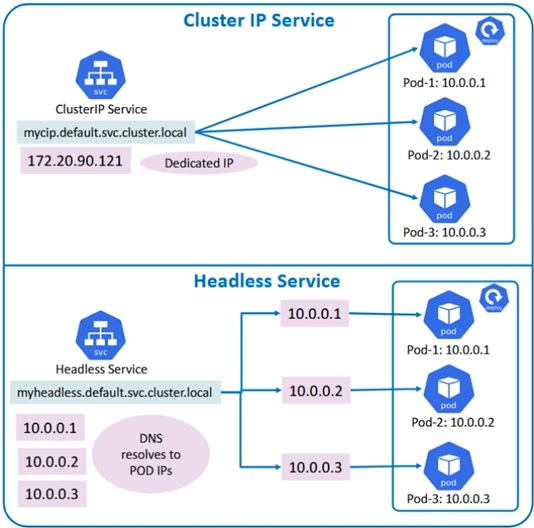

# Kubernetes StatefulSet 
- Cleanup
```
List existing resources
kubectl get all
Delete the PVC's
kubectl delete pvc --all
Delete another resources
kubectl delete all --all
List existing resources
kubectl get all
```

## Manages stateful applications
- Used for apps needing:
	- Stable pod names
	- Persistent storage
	- Ordered startup/shutdown
	- Stable network identity

- For Examples:
	- MySQL
	- PostgreSQL
	- MongoDB
	- Kafka
	- Elasticsearch
	- ETC...
## Summary step 01 - 09 
1. Stable pod names	web-0 always stays web-0
2. Persistent storage	Each Pod keeps data
3. Ordered deployment	Pods start sequentially
4. Ordered scaling	Controlled startup/shutdown
5. Rolling updates	Safe sequential updates 
6. StatefulSets provide stable identity and persistent storage for stateful Kubernetes applications.
   
### Step 01
- Create the a Headless service for the StatefulSet
<p align="left">
  
</p>
DNS returns the IP addresses of each pod directly. curl nginx → gets a list of all pods.  
MySQL cluster, Kafka, Zookeeper - you need to know the specific node, not a random pod.  

```
kubectl create -f service.yaml
kubectl get svc

```
### Step 02
- Create StatefulSet

```
kubectl delete statefulset web
kubectl apply -f statefulset.yaml
kubectl get statefulsets
```
### Step 03
- Inspect the StatefulSet pods
```
kubectl get pods -l="app=nginx"
	# Output
web-0
web-1
web-2
```
### Step 04
- Inspect the StatefulSet's PV, PVCs and storageclass
  
```
kubectl get pv
kubectl get pv | awk '{print $1,"        "$5 }'

	# Output
NAME         RECLAIM
pvc-6648fe9f-e7a8-4eb6-b93b-1e9571df7ecd         Bound  
pvc-8fd53f04-506b-4a25-a2a1-10f1160c752f         Bound  
pvc-9d200150-a012-4b8f-b2ac-b5c270028207         Bound  

kubectl get storageclass
kubectl get pvc | awk '{print $1,"        "$3 }'
	#output
NAME         VOLUME
www-web-0         pvc-6648fe9f-e7a8-4eb6-b93b-1e9571df7ecd
www-web-1         pvc-8fd53f04-506b-4a25-a2a1-10f1160c752f
www-web-2         pvc-9d200150-a012-4b8f-b2ac-b5c270028207

Connections between objects:
StatefulSet (web)
├── Pod web-0 → PVC www-web-0 → PV pvc-6648fe9f...
├── Pod web-1 → PVC www-web-1 → PV pvc-8fd53f04...
└── Pod web-2 → PVC www-web-2 → PV pvc-9d200150...

```
### Step 05
-  Scale Up StatefulSet, Edit StatefulSet
	- Change from replicas 3 to replicas: 5
	
```
kubectl edit statefulset web
kubectl get pods -l="app=nginx" --watch

 # Output
NAME    READY   STATUS    RESTARTS   AGE
web-0   1/1     Running   0          5h44m
web-1   1/1     Running   0          5h44m
web-2   1/1     Running   0          9s
web-3   1/1     Running   0          8s
web-4   1/1     Running   0          7s

 # Verify Pods
kubectl get pods -l="app=nginx"
 # Verify StatefulSet
kubectl get statefulset web
```

### Step 06
-  Scale down StatefulSet, Edit StatefulSet
	- Change from replicas 5 to replicas: 2
```
kubectl edit statefulset web
kubectl get pods -l="app=nginx" --watch

	# Output
NAME    READY   STATUS    RESTARTS   AGE
web-0   1/1     Running   0          5h51m
web-1   1/1     Running   0          5h51m

# Pods terminate in reverse order:
	# web-4 deleted first
	# web-3 deleted next
```

### Step 07
- Update StatefulSet, Edit StatefulSet image
 - Replace from gcrcontainer/nginx-slim:0.20 to gcrcontainer/nginx-slim:0.26

```
kubectl edit statefulset web

```
### Step 08
- Watch rollout
```
kubectl rollout status statefulset web

Updates occur one Pod at a time:
Ordered rolling update
web-0
web-1
web-2

 # Verify images
kubectl describe pod web-0 | grep Image:
kubectl describe pod web-1 | grep Image:

Expected:

gcrcontainer/nginx-slim:0.26

```
### Step 09

- Rollback StatefulSet
```
kubectl rollout undo statefulset web

	# Restores previous version.
kubectl rollout status statefulset web
	# Verify rollback image
kubectl describe pod web-0 | grep Image:
kubectl describe pod web-1 | grep Image:

	# Output
    gcrcontainer/nginx-slim:0.20

```
### Clean all pvc / pv
```
kubectl delete statefulset web
kubectl delete pvc --all
# PV will be deleted automatically as RECLAIMPOLICY: Delete
```